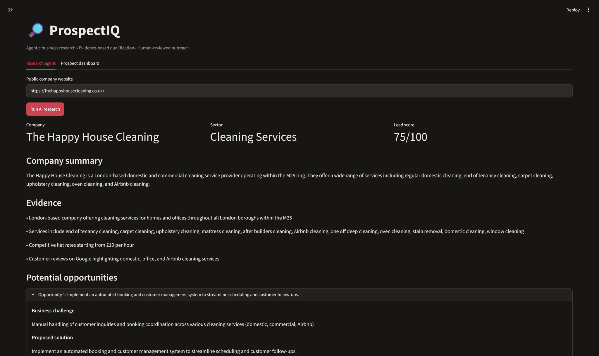
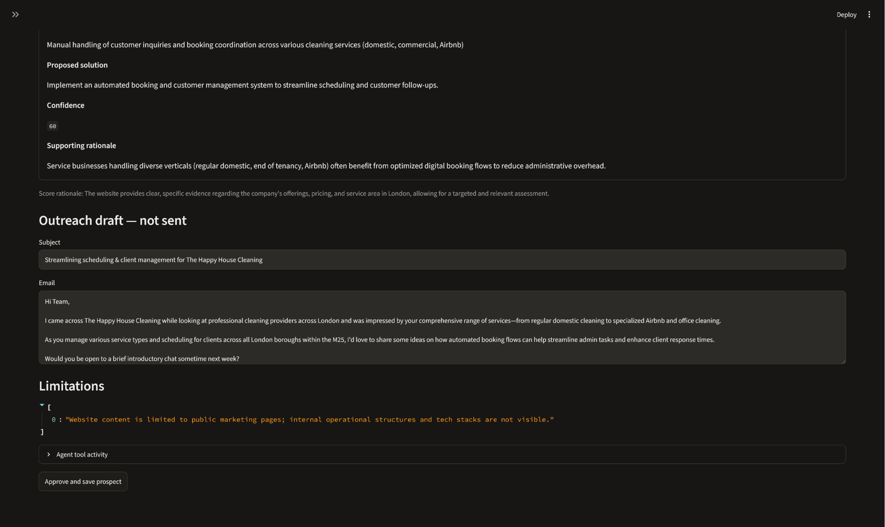
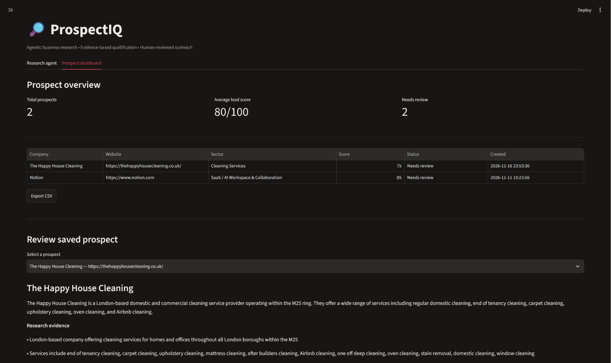

# 🔎 ProspectIQ — Agentic AI Business Research

**AI-powered business research • Evidence-based lead qualification • Human-reviewed outreach**

ProspectIQ is an AI-powered business research prototype that uses Google's Gemini API to analyse public company websites, identify potential business opportunities, generate lead qualification scores, and prepare personalised outreach drafts.

The project explores how AI agents and workflow automation can support business research, lead generation, and sales operations while keeping important decisions under human control.

## ✨ Key Features

- **AI-powered website research:** Analyses an approved public company website using Gemini and Python-based website retrieval.
- **Agent tool calling:** Uses Gemini function calling to retrieve website content through a controlled Python tool.
- **Lead qualification:** Generates a lead score from 0–100, supporting rationale, and company information.
- **Business opportunity identification:** Suggests potential improvements and automation opportunities based on available website evidence.
- **Personalised outreach drafts:** Generates relevant outreach emails for human review without automatically sending messages.
- **Prospect management dashboard:** Stores research reports in SQLite and allows users to review saved companies.
- **Review status tracking:** Supports prospect qualification and review decisions.
- **CSV export:** Allows saved prospect data to be exported for further analysis.
- **Safety controls:** Includes URL validation, restricted website fetching, and human approval before saving research.

## 📸 Screenshots

### 1. AI Research Report

Research output showing company information, lead qualification score, supporting evidence, and potential business opportunities.



### 2. AI-Generated Outreach

A suggested business opportunity and personalised outreach draft generated for human review.



### 3. Prospect Dashboard

Dashboard displaying saved prospects, lead scores, review statuses, and research information.



## 🛠️ Tech Stack

| Technology | Purpose |
|---|---|
| Python | Application logic and backend processing |
| Google Gemini API | AI research, analysis, and text generation |
| Streamlit | Interactive web interface |
| SQLite | Local prospect data storage |
| Requests | Website content retrieval |
| BeautifulSoup | HTML parsing and text extraction |
| Pandas | Data handling and CSV export |
| Git & GitHub | Version control and project hosting |

## ⚙️ How It Works

1. The user enters a public company website URL.
2. ProspectIQ validates the URL and initiates Gemini-powered research.
3. The AI agent calls a Python website retrieval tool to collect public website content.
4. Gemini analyses the retrieved information and generates a structured research report.
5. The report includes company information, supporting evidence, potential opportunities, a lead score, and an outreach draft.
6. The user reviews the report and chooses whether to save the prospect.
7. Saved prospects can be reviewed, assigned statuses, and exported as CSV.

**Workflow:**

`Company URL → URL Validation → Gemini Tool Calling → Website Retrieval → AI Research Report → Human Review → SQLite Database → Dashboard / CSV Export`

## 🚀 Installation and Setup

### Prerequisites

- Python 3.10 or later
- A Google Gemini API key
- Git (optional, for cloning the repository)

### 1. Clone the Repository

```bash
git clone https://github.com/waleed7-ai/ProspectIQ.git
cd ProspectIQ
```

### 2. Create a Virtual Environment

```bash
python -m venv .venv
```

Activate it on Windows PowerShell:

```powershell
.\.venv\Scripts\Activate.ps1
```

### 3. Install Dependencies

```bash
pip install -r requirements.txt
```

### 4. Configure Your Gemini API Key

Get your own Gemini API key from [Google AI Studio](https://aistudio.google.com/api-keys).

You can enter the key directly into the **Gemini API key** field in the application's sidebar.

Alternatively, copy `.env.example` to `.env` and configure your key locally.

**Important:** No private API keys are included in this repository. Users must supply their own Gemini API credentials to run AI research.

The application uses `gemini-3.5-flash-lite` as its configured default model. Model availability and API quotas may vary by account.

### 5. Run the Application

```bash
streamlit run app.py
```

Open the local Streamlit URL displayed in your terminal, normally:

`http://localhost:8501`

Enter a public company website URL and click **Run AI research**.

## 🧪 Testing and Validation

The following features were manually tested during local development:

- [x] Public company website research
- [x] AI-generated company summaries and evidence
- [x] Lead scoring and opportunity suggestions
- [x] Human-reviewed outreach draft generation
- [x] Saving approved prospects to SQLite
- [x] Displaying saved prospects in the dashboard
- [x] Updating prospect review statuses
- [x] Exporting saved prospect data to CSV

### Further Testing and Improvements

- [ ] Automated unit and integration tests
- [ ] More comprehensive URL security testing
- [ ] Wider testing across unavailable and JavaScript-heavy websites
- [ ] Evaluation of lead-scoring consistency and reliability
- [ ] Production deployment and additional security controls

## 💡 Development Process & My Contribution

I developed ProspectIQ as a hands-on project to explore how AI agents can automate business research and support lead qualification.

Throughout development, I worked on setting up the application environment, integrating and configuring the Gemini API, troubleshooting API errors, and testing the complete research workflow.

I also validated key features, including website analysis, AI-generated reports, lead scoring, SQLite data storage, prospect status management, and CSV exports.

The project was built with extensive AI-assisted coding and development guidance, which helped me experiment with unfamiliar technologies, troubleshoot issues, and understand how different components work together.

ProspectIQ is currently a functional local prototype, with opportunities for further improvements in lead scoring, reliability, and deployment.

## ⚠️ Current Limitations

- The agent analyses a single public HTML page rather than crawling an entire website.
- Some websites may block automated requests or rely on JavaScript-rendered content.
- Lead scores and suggested business opportunities are AI-generated estimates rather than verified business assessments.
- Generated outreach drafts require human review and are never automatically sent.
- Gemini API availability, rate limits, and response times may vary.
- Additional network-level security, testing, and monitoring would be required before production deployment.

## 🔮 Future Improvements

Potential future development includes more consistent lead-scoring criteria, multi-page website analysis, automated testing, additional CRM integrations, and secure cloud deployment.

## 📌 Project Status

**Functional local prototype — portfolio and learning project.**

ProspectIQ demonstrates practical experimentation with AI agents, tool calling, API integration, business workflow automation, and human-in-the-loop review.
